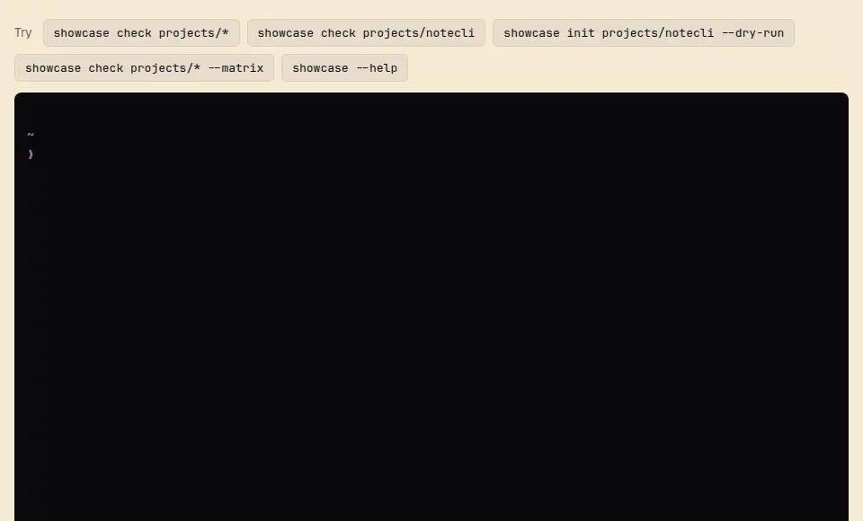

# showcase

Grade how demoable a project is, from D to S, and get the exact next steps to raise it.

**[Try it in your browser](https://showcase.soleone.xyz)**, no install.



## Quick start

```sh
npx @soleone/showcase check   # grade the project in the current directory, no install
npm i -g @soleone/showcase    # or install it to get the `showcase` command
showcase check                # grade the project in the current directory
showcase check ~/code/a ~/code/b --verbose
showcase check ~/code/a ~/code/b --matrix   # every check against every project
showcase init                 # draft showcase.json from the README and package.json
showcase capture              # re-record the media with media.capture and check the loop
showcase terminal --serve     # build the in-browser terminal demo for a CLI
showcase manage               # find, review, grade and edit your projects; no setup
showcase guide                # how to make a project demoable, for agents and people
```

No dependencies; needs Node 22 or later.

## With an agent

The CLI teaches an agent how to use it, so there is nothing to install beyond showcase. Tell your agent to run `showcase guide` (or `npx @soleone/showcase guide`), or add that line to your AGENTS.md. It prints the loop, the tiers and what to ask you first, plus a list of topics (`showcase guide media`, `terminal`, `portfolio` and more) that the agent reads only when a step needs one. Every failing check names the topic that helps.

If you would rather have your agent find it by itself, the package also ships a tiny `showcase` skill that only says "run `showcase guide`":

```sh
pi install npm:@soleone/showcase                          # pi
/plugin install showcase --marketplace Soleone/showcase   # Claude Code
npx skills add Soleone/showcase                           # other agents
```

Then ask your agent to make a project demoable, or to take it up a tier. The text is in [docs/guide](docs/guide/index.md).

## Tiers

Each tier includes everything below it.

| Tier | Means | Checked by |
|---|---|---|
| **D** | Nothing to show yet | |
| **C** | The README says what it is and how to run it | README present, 80+ words, a usage section or code block |
| **B** | The README sells it | Pitch right under the title, hero visual before the first section, 1,200 words or fewer, no broken local links |
| **A** | It shows itself in motion | Valid `showcase.json`, a looping WebP, GIF or video, a one-command local demo |
| **S** | One click to try it for real | `live` URL that responds |

What "live" means depends on the kind of project: a hosted demo with sample data for a web app, an in-browser terminal for a CLI, a store listing for a browser extension, a replay for an agent. Set `ceiling` when a tier is out of reach, for example `"A"` for something that cannot be hosted, and `check` stops suggesting it.

## showcase.json

The project's facts for any portfolio to use. How much a portfolio cares about the project (featured, order) lives in the portfolio, not here.

```json
{
  "$schema": "https://raw.githubusercontent.com/Soleone/showcase/main/schema/showcase.schema.json",
  "title": "notecli",
  "pitch": "Turns a folder of session logs into a daily journal you can read.",
  "description": "Reads the session logs your coding agent already saves, groups them by day and writes a Markdown journal. Your handwritten notes are never touched.",
  "kind": "cli",
  "stage": "product",
  "year": 2026,
  "tech": ["Node.js"],
  "repo": "https://github.com/you/notecli",
  "live": "https://notecli.example.com",
  "media": {
    "hero": "docs/media/hero.png",
    "motion": "docs/media/demo.webp",
    "video": "docs/media/demo.mp4",
    "capture": "npm run demo:capture"
  },
  "brand": {
    "icon": "docs/brand/icon.svg",
    "colors": ["#5b8def", "#222222"]
  },
  "demo": {
    "strategy": "browser-terminal",
    "local": "npm run demo",
    "externals": [
      { "name": "LLM summaries", "type": "model", "seam": "modelCommand setting", "standIn": "canned",
        "note": "A stand-in returns canned summaries, so nothing is sent to a model." }
    ]
  }
}
```

`pitch` is the one-sentence subtitle. `description` goes further (how it works, what sets it apart) without repeating the pitch, so a portfolio can show both, for example a card with the pitch on its front and the description on its back.

`brand` (`icon`, `logo`, `wordmark`, `colors`) is optional and never changes the tier; a web app, desktop app or extension without `brand.icon` gets advice, since it needs one for its favicon.

`demo.externals` makes explicit what the project needs that a demo cannot reach (a model, an account, hardware, a service, another app), where a stand-in plugs in without changing the code (`seam`), and which stand-in the demo uses: `canned`, `replay`, `simulated`, `bring-your-own`, `real` or `omitted`. `[]` says there are none. Demo pages use each `note` to tell visitors what is not real.

The full contract is [schema/showcase.schema.json](schema/showcase.schema.json). Fields starting with `x-` are allowed for your own extensions.

## Feed a portfolio site

A portfolio picks its projects in `portfolio.json`, in the order it shows them ([schema](schema/portfolio.schema.json)):

```json
{
  "projects": [
    { "id": "local:notecli", "priority": "high", "path": "$HOME/code/notecli" },
    { "id": "github:you/old-library", "title": "old-library", "priority": "low", "repo": "https://github.com/you/old-library" }
  ]
}
```

```sh
showcase collect portfolio.json --out public/showcase
```

This writes `feed.json` with one entry per project: its showcase.json facts (or a draft from the README when it has none), `tier`, `target` and `gap`, the required checks still failing up to the target. Priority sets the target: high S, mid A, low C, capped by `ceiling`. Local media is copied to `media/<slug>/` and brand files to `brand/<slug>/`, and the feed points at the copies. Projects without a local path are listed ungraded.

## Browse and edit your projects

```sh
showcase manage
```

No setup. It finds your portfolio.json (or creates one and asks which folders hold your projects), then shows every project with its tier, the goal its priority sets and what is still missing. `tab` switches to a review of every project it can find in those folders and on GitHub, to include or ignore. Edits are written right away, as one-line diffs. Keys and details: [docs/manage.md](docs/manage.md).

For scripts and other tools, the same portfolio is available without the UI:

```sh
showcase list --json                                  # the projects, in portfolio order
showcase add ~/code/notecli --priority high
showcase add --repo https://github.com/you/old --id github:you/old   # no local folder
showcase set local:notecli --priority mid
showcase set local:notecli --stage prototype          # saved in its showcase.json
showcase remove local:notecli                         # its files stay
showcase discover --root ~/code                       # scan folders and GitHub; --json, --status review
showcase ignore local:old/thing                       # decide against it; unignore puts it back
showcase collect --out public/showcase                # no path needed either
```

Each takes `--config <file>` to use another portfolio.

## Keep the media fresh

Set `media.capture` to the command that re-records your screenshots and loops, and `showcase capture` runs it, then checks `media.motion`: animated, loops forever, at least 640 px wide, 3 to 30 s, under 3 MB. `--no-record` checks the file you have.

For a web app, `@soleone/showcase/capture` writes that command for you, minus the parts only your app knows. It records a fresh browser session with [agent-browser](https://github.com/vercel-labs/agent-browser) and encodes a looping WebP with FFmpeg (both on the PATH); you write how to start, drive and judge a take:

```js
import { record } from "@soleone/showcase/capture";

await record({
  url: "https://your-app.example.com",
  out: "docs/media/demo.webp",
  start: (page) => page.waitFor(`document.querySelector("main")`),
  drive: async (page) => { await page.click("Play"); await page.sleep(10_000); },
  verify: async (page) => (await page.eval(`document.title`)).includes("Done") ? undefined : "did not finish",
  attempts: 3,
});
```

`showcase guide media` ([docs/guide/media.md](docs/guide/media.md)) has what to watch for when recording.

## Try a CLI in the browser

For a CLI, S means a visitor can run it. `showcase terminal` builds a static page that runs your real CLI in a Node.js sandbox in the browser ([WebContainers](https://webcontainers.io)), with sample data and stand-ins for anything it cannot reach:

```sh
showcase terminal --serve   # builds demo/browser/terminal.json into dist/browser
```

Deploy `dist/browser` to any static host; it includes a `vercel.json` with the headers the sandbox needs. [recipes/browser-terminal](recipes/browser-terminal/README.md) explains `terminal.json` and the sandbox's quirks, and showcase's own demo in [demo/browser](demo/browser/terminal.json) is a working example.

## Scripting

`showcase check --json` prints every check with its status, detail and hint. `--min B` exits with status 1 when any project is below B, which is handy in CI. `--offline` skips requesting live URLs.

## Development

```sh
npm test
npm run demo            # grade the sample projects in demo/projects
npm run demo:browser    # the same in the browser terminal, on 127.0.0.1:4321
npm run media:capture   # re-record docs/media from the browser demo
```

Releases run from your machine with release-it. Commit with Conventional Commits (`feat:`, `fix:`); `npm run release` then tests, picks the next version, writes `CHANGELOG.md`, commits, tags and publishes to npm. `npm run release:dry-run` shows what it would do. The very first release publishes the version already in package.json: `npm run release -- --no-increment`.
